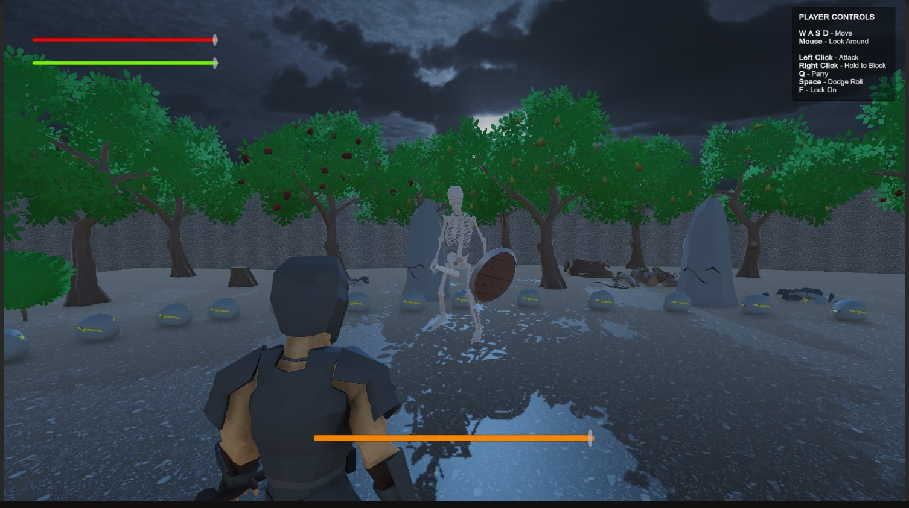
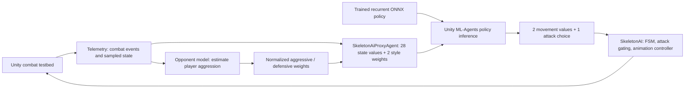
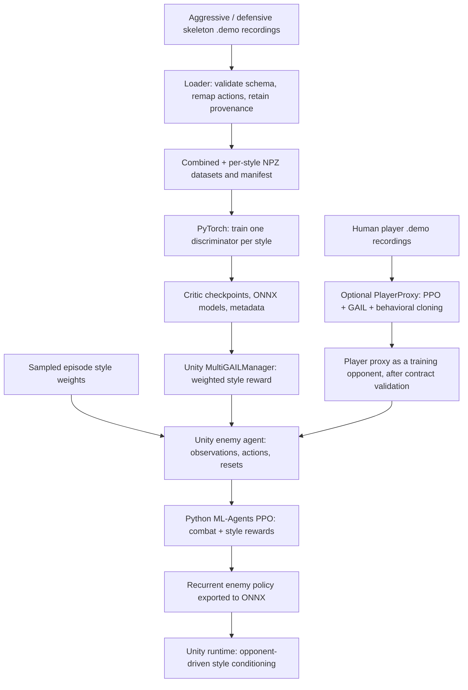
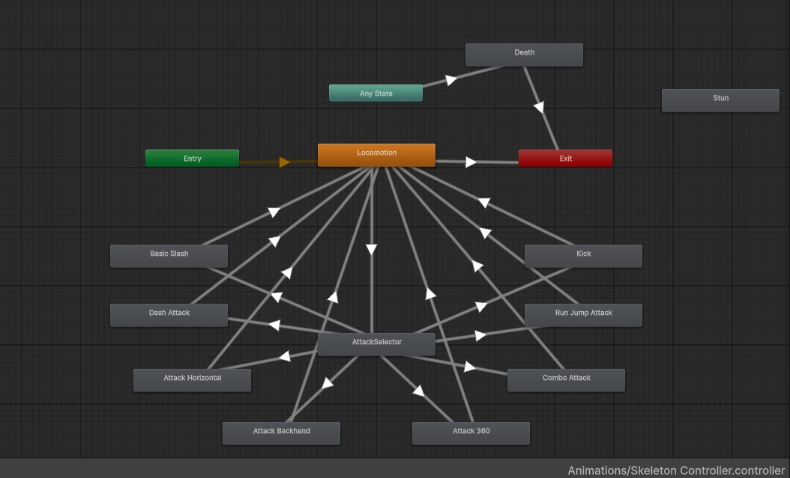

# Adaptive Enemy Framework

**A Unity combat AI pipeline combining PPO, imitation learning, per-style MultiGAIL critics, and telemetry-driven opponent modelling.**

Scripted enemies repeat fixed patterns even as a player changes tactics. Adaptive Enemy Framework explores how an enemy can use combat telemetry and learned aggressive/defensive styles to change its decisions during a fight. A style-conditioned policy selects movement and attacks, while a C# finite state machine handles combat execution.

**Effan Shakeel designed and implemented the AI pipeline and its Unity integration.** This is a team project hosted under `Sunbro26`; individual responsibilities are listed in [Contributors / My Contribution](#contributors--my-contribution).

[Effan's LinkedIn](https://www.linkedin.com/in/effan-shakeel-42a58721a/) · [Run the Unity demo](#run-the-unity-demo) · [Reproduce training](#reproduce-training) · [Results](#results--observations)

## At a glance

- **Separate critic training:** a PyTorch trainer exports one aggressive and one defensive discriminator to ONNX, with validation splits and model metadata.
- **Committed demonstration datasets:** 6,466 state-action rows from 10 source recordings, with combined and per-style NPZ files and a provenance manifest.
- **Connected Unity integration:** `MainStage` assigns both critics and a recurrent enemy policy; the agent appends style weights to its observations and adds the blended critic reward during PPO training.
- **Runtime adaptation:** a telemetry-based opponent model updates aggressive/defensive weights during combat, with manual presets and an overlay for inspection.
- **Combat execution:** an enemy FSM, attack library, animation controller, cooldown/range checks, action masks, and episode-reset handling connect policy decisions to the game.



*Actual project screenshot extracted from the supplied project report, Figure 2.1. The playable demo is [MainStage](Assets/Scenes/MainStage.unity); a hosted gameplay video has not been supplied.*

## Contributors / My Contribution

| Contributor | Responsibility |
| --- | --- |
| **Effan Shakeel** | **AI pipeline design and implementation:** reinforcement/imitation-learning research, enemy state machines and controllers, Unity ML-Agents integration, and integration of demonstration processing, style critics, opponent modelling, and runtime inference. |
| **Abdullah Hussain / Sunbro26** | Gameplay engineering. |
| **Muniba Noor** | Telemetry and PPO work. |

### My contribution — Effan Shakeel

I designed and implemented the AI pipeline, from researching reinforcement learning and imitation learning to integrating learned decisions with Unity combat. My work included:

- Implementing the enemy finite state machine and setting up its controllers and attack execution.
- Integrating Unity ML-Agents, including observations, actions, reward handling, and the episode lifecycle.
- Connecting the demonstration-data pipeline and separate aggressive/defensive critic models to the enemy training workflow.
- Integrating the style-conditioned enemy agent, telemetry-based opponent modelling, and ONNX inference into the runtime.

These responsibilities describe my AI architecture and implementation work within the team; Muniba contributed telemetry and PPO work, and Abdullah handled gameplay engineering.

## Architecture



The policy is the decision layer. [`SkeletonAI`](Assets/Scripts/Enemy/SkeletonAI.cs) is the execution layer: it handles `Idle`, `Strategizing`, `Maneuvering`, `Attacking`, `Retreating`, and `Stunned` states, attack timing, and movement. [`SkeletonAiProxyAgent`](Assets/Scripts/Enemy/SkeletonAiProxyAgent.cs) bridges the policy to this body through `SetMovementInput` and `RequestAttack`, and masks attacks that are unavailable because of cooldown, range, facing, or combat locks.

### PPO / Unity ML-Agents

Unity generates observations, applies actions, computes rewards, and resets episodes. The Python ML-Agents trainer optimizes the PPO policy; exported ONNX policies run through Unity ML-Agents at inference time. Separately, [`MultiGAILManager`](Assets/Scripts/ML%20Agents/MultiGAILManager.cs) runs the style critics through Unity's Inference Engine, including GPU-to-CPU tensor readback.

The saved [enemy training configuration](results/SkeletonMultiGAIL_v1/configuration.yaml) uses PPO with three 256-unit layers, observation normalization, and recurrent memory of size 128 with sequence length 64. Its batch size is 512, rollout buffer is 8,192, learning rate is `3e-4`, and time horizon is 128. The configured budget is 2,000,000 steps; this is a training target, not evidence that every recorded run completed that budget.

The Unity reward combines damage dealt/taken, win/loss, range and attack-validity shaping, a step penalty, and the weighted style reward. The configuration exposes this aggregate as the **extrinsic** reward signal. The code's small `engagementReward` is a range/facing shaping term, not a measurement of human engagement.

### Observation and action contract

For the current eight-attack enemy and two styles:

| Interface | Contract |
| --- | --- |
| Raw enemy state | 28 floats: FSM/damage state, distance and directions, health/stamina, distance change, defensive success rates, damage/attack statistics, and eight attack-success rates. |
| Policy observation | 30 floats: the 28 raw values followed by `[aggressive_weight, defensive_weight]`. |
| Continuous action | Two values, ordered `[strafe, forward]`. |
| Discrete action | One branch of size 9: `0` = no attack; `1..8` select the eight attacks. |
| Critic input | 39 floats: 28 raw observations + 2 continuous actions + 9 one-hot discrete values. Style weights are excluded. |

Observation ordering is defined in `PopulateRawObservations` and `PopulatePolicyObservations` in the enemy agent. Changing the attack library or style count changes the contract and requires matching datasets, Behavior Parameters, and models.

## What MultiGAIL is used for

MultiGAIL is used here to give one enemy policy multiple learned style objectives. Each style has a separate state-action discriminator, and a normalized style vector controls both the policy's conditioning and how discriminator rewards are blended. This supports pure aggressive/defensive endpoints and intermediate blends without switching the policy asset for each decision.

The repository implements a **MultiGAIL-style pipeline with separately trained, fixed critics**. [`train_multigail_critics.py`](tools/train_multigail_critics.py) learns each critic offline from labelled demonstrations: its own style is positive and the other demonstrated styles are negative. The committed trainer does not alternate discriminator updates against newly collected policy rollouts, so these artifacts should not be described as a complete online adversarial MultiGAIL training loop.

### Per-style critics

Each critic is a normalized MLP with two 256-unit ReLU layers and a scalar output. Training uses class-weighted least-squares loss with targets `+1` for the selected style and `-1` for other styles, balanced sampling, and early stopping on validation loss. Input normalization is fitted on the training split and included in the exported model.

`MultiGAILManager` converts each score into a style-match reward and blends it:

```text
style_match_i = max(0, 1 - 0.25 * (critic_score_i - 1)^2)
style_reward  = sum(alpha_i * style_match_i)
```

Critic order is **aggressive, defensive**. The main scene uses a style-reward scale of `0.15`; the script default is `0.05`. The critics shape the PPO reward; the exported enemy policy chooses gameplay actions.

## Opponent modelling and behavior examples

[`Telemetry`](Assets/Scripts/Telemetry/Telemetry.cs) combines combat events with per-frame spatial/resource samples and recent histories over a 10-second window. The opponent model uses recent attacks, damage dealt, stamina expenditure, proximity, approach/retreat movement, and block/parry/dodge success to estimate player aggression.

This is a **rule-based weighted estimator**, not a separately trained playstyle classifier. It recomputes the target blend every `0.5` seconds by default and either smooths or immediately applies the weights. During Python-connected training, opponent-driven shifts are suspended when the agent owns episode resets, keeping the sampled episode style target fixed.

| Player behavior | Effect in the current opponent model | Behavior to inspect in the demo |
| --- | --- | --- |
| Frequent attacks, damage, stamina commitment, and closing distance | Increases the aggressive weight. | Whether the conditioned enemy closes distance and commits to attacks more often. |
| Successful blocks/parries/dodges, retreating, wider spacing, and fewer attacks | Increases the defensive weight. | Whether the enemy preserves spacing and uses more cautious attack timing. |
| Mixed behavior or a manual `0.5/0.5` or `0.6/0.4` preset | Conditions the same policy on a blended style. | How movement and attack selection change between endpoints and mixtures. |

These are inspection examples, not quantified outcome claims. The current estimator maps player aggression directly to enemy aggression; a separate learned counter-strategy selector is not implemented in this path.

## Demonstration-data and training pipeline



The [`demonstration loader`](tools/load_skeleton_multigail_demos.py) reads Unity `.demo` state-action records, matches filename prefixes to styles, rejects incompatible schemas, and exports raw/policy observations, continuous actions, discrete actions, one-hot encodings, style labels, and file/row identifiers. The legacy discrete action `9` is remapped to no-op `0`. A one-hot style label is appended to the exported policy observations; critics use the unconditioned state-action input.

[`manifest.json`](results/multigail_dataset/manifest.json) records accepted/skipped files, schemas, counts, and remapping. The exported NPZ files feed the separate critic trainer; they are not a direct input to `mlagents-learn` PPO training.

The optional player-proxy route has its own [`PlayerProxyAgent`](Assets/Scripts/Player/PlayerProxyAgent.cs), recorded player demonstrations, and [PPO + GAIL + behavioral-cloning configuration](config/player_trainer_config.yaml). This is distinct from training the skeleton's per-style critics.

## Results / Observations

The committed dataset contains **2,901 aggressive rows from 3 recordings** and **3,565 defensive rows from 7 recordings**. The [critic summary shipped with the runtime models](Assets/Models/MultiGAIL/training_summary.json) records 4,973 training rows and 1,493 validation rows, holding out one entire recording per style without partial-file validation slices in that run.

| Shipped critic | Training sign accuracy | Validation sign accuracy | Selected epoch |
| --- | ---: | ---: | ---: |
| Aggressive | 96.78% | 96.72% | 2 |
| Defensive | 96.56% | 96.12% | 2 |

Accuracy measures whether the discriminator score has the correct sign for its style label. These are validation figures from one recorded run, not an independent test set or evidence of improved engagement, combat strength, or successful behavior blending. Adjacent rows within recordings are temporally correlated.

Additional inspectable evidence:

- [`Skeleton_MasterBrain_v1`](results/Skeleton_MasterBrain_v1) includes a checkpoint/export at **250,424 training steps**, a saved PPO configuration, TensorBoard events, and run metadata.
- [`SkeletonDefensive_v1`](results/SkeletonDefensive_v1) and [`PlayerProxyU1`](results/PlayerProxyU1) contain additional model exports and training artifacts.
- `MainStage` references the 30-input recurrent master policy and both 39-input critics. Its serialized observation/action settings match the enemy dataset and model input dimensions.

There are no committed raw participant responses or reproducible engagement statistics establishing an improvement over the scripted baseline, and no profiler benchmark establishing inference overhead. Those outcomes remain unverified. The `SkeletonMultiGAIL_v1` directory contains configuration/run metadata but no saved policy checkpoint.

## Run the Unity demo

1. Clone the repository and add its root folder as a project in Unity Hub:

   ```powershell
   git clone https://github.com/Sunbro26/FYP.git
   cd FYP
   ```

2. Open with **Unity 6000.2.6f2** and allow the packages in `Packages/manifest.json` to resolve.
3. Open [`Assets/Scenes/MainStage.unity`](Assets/Scenes/MainStage.unity). For a continuous adaptation demo, uncheck **Start Experiment Automatically** on `SurveyUI` before pressing Play; the checked-in scene otherwise starts a timed heuristic/survey/inference flow.
4. Confirm the enemy's Behavior Parameters use **Inference Only**, behavior name `SkeletonAI`, vector size **30**, **2** continuous actions, one discrete branch of **9**, and [`SkeletonAI_Master.onnx`](Assets/Models/SkeletonAI_Master.onnx). `SkeletonAI.useExternalAI` must be enabled. The scene already assigns the aggressive and defensive critics to `MultiGAILManager` in that order.
5. Leave the player on **Heuristic Only** with Player Input enabled, then press Play. This path uses human control and does not require the Python trainer.

| Control | Action |
| --- | --- |
| WASD / mouse | Move / look |
| Left click / right click | Attack / hold block |
| Q / Space / F | Parry / dodge / lock on |
| 1 / 2 | Force aggressive / defensive style |
| 3 / 4 | Force `0.5/0.5` / `0.6/0.4` blend |
| 5 / 6 / 7 | Toggle opponent shifts / immediate shifts / debug overlay |

Bindings above come from [`PlayerInput.inputactions`](Assets/Input/PlayerInput.inputactions). Disable opponent shifts with **5** when comparing manual presets, otherwise the next opponent-model update replaces the preset target. The overlay shows estimated aggression and current/target weights.

For the scripted baseline, use `EnemyControlModeSwitcher.SwitchToHeuristicOnly()`; the inverse method restores inference control. The scene's survey flow calls these methods automatically and currently serializes **120 seconds per gameplay phase**.

[`ACF_DemoScene`](Assets/AdaptiveCombatFramework/Scenes/ACF_DemoScene.unity) and the prefabs in [`AdaptiveCombatFramework`](Assets/AdaptiveCombatFramework) provide a separate integration example. Check model assignments there explicitly; the packaged enemy prefab has no policy assigned. When moving the framework into another project, create the `sword` tag and `Enemy` layer and wire the scene references described in its [integration notes](Assets/AdaptiveCombatFramework/README.txt).

<details>
<summary>Enemy animation / attack controller screenshot</summary>



*Actual controller screenshot from the supplied project report, Figure 3.3.*

</details>

## Reproduce training

Run commands from the repository root. Use a **CPython 3.10.1–3.10.12** environment, matching `pyproject.toml`. The dependency files target Windows and pin ML-Agents `1.1.0`, NumPy `1.23.5`, ONNX `1.15.0`, and PyTorch `2.1.1+cpu`.

```powershell
python -m venv .venv
.\.venv\Scripts\Activate.ps1
python -m pip install --extra-index-url https://download.pytorch.org/whl/cpu -r requirements.txt
```

If using the committed `uv.lock` instead, run `uv sync --locked` with a Python interpreter in that range, then activate `.venv`. Saved PPO run metadata reports PyTorch `2.2.1+cu121`, which differs from the current CPU dependency pins; bit-for-bit reproduction of those historical runs is not established. Fresh dependency installation and Unity execution have not been verified as part of this README update.

### 1. Retrain the critics from committed datasets

This route works from the exported dataset and does not require the original `.demo` files:

```powershell
python tools/train_multigail_critics.py --dataset-dir results/multigail_dataset --output-dir results/multigail_critics_repro --hidden-sizes 256,256 --batch-size 256 --epochs 50 --patience 8 --learning-rate 0.0003 --weight-decay 0.00001 --val-files-per-style 1 --seed 7 --device cpu
```

The trainer writes per-style `.pt` and `.onnx` files, critic metadata, and `training_summary.json`. Keep new outputs separate from the shipped artifacts. To use the new critics in Unity, copy the ONNX files into a new folder under `Assets/Models`, allow Unity to import them, and assign them to `MultiGAILManager` in aggressive/defensive order.

### 2. Regenerate the demonstration dataset

The manifest's **10 original skeleton recordings are absent from this checkout**; `config/` is ignored except for files already tracked. Obtain those source files or record new compatible demonstrations before running the loader. With newly recorded data, this recreates the pipeline rather than the exact historical dataset.

Capture raw skeleton observations using a recording agent configured for **28 observations**, **2** continuous actions, and the matching attack branch. The current style-conditioned agent emits **30** observations, so recording it unchanged is not compatible with the loader's 28-value raw-state contract. Use filenames beginning `SkeletonAggressi` and `SkeletonDefensiv`, and keep separate recordings for validation.

```powershell
python tools/load_skeleton_multigail_demos.py --demo-root config/SkeletonDemos --expected-raw-observation-size 28 --expected-continuous-size 2 --expected-discrete-branch-size 9 --append-style-conditioning --output-dir results/multigail_dataset_repro
```

Check the resulting manifest for skipped files and schema changes, then point the critic trainer at the new dataset directory. If only one recording is available for a style, the trainer can fall back to a within-file validation slice; report that weaker split explicitly.

### 3. Train the style-conditioned enemy with PPO

In `MainStage`, disable the automatic survey flow, set the enemy Behavior Type to **Default**, and retain its 30/2/9 contract and both critic assignments. Keep `ownEpisodeResets` and `sampleStyleWeightsEachEpisode` enabled. Use a human-controlled player for an initial connection check, or a separately validated proxy for automated rollouts.

```powershell
mlagents-learn results/SkeletonMultiGAIL_v1/configuration.yaml --run-id SkeletonMultiGAIL_repro --seed 7
```

When the trainer waits for a connection, press Play in Unity. Combat callbacks defer episode termination to `Update`; the agent owns simulation resets while connected to Python. Stop training normally to export the policy, then import the new ONNX file into Unity and restore **Inference Only** for playback.

```powershell
tensorboard --logdir results
```

Retain the run configuration, seed, package/device versions, event logs, checkpoints, and exported model together. The selected seed controls the Python training setup; full Unity/physics determinism has not been established.

### Optional player-proxy training

The [proxy config](config/player_trainer_config.yaml) references `config/PlayerAggressive_98.demo`, which is missing. Replace **both** GAIL and behavioral-cloning paths with a demonstration whose observation/action contract matches the current proxy before training:

```powershell
mlagents-learn config/player_trainer_config.yaml --run-id PlayerProxy_repro --seed 7
```

The current proxy script/scene use **22** vector observations, while the shipped `PlayerProxy.onnx` declares an observation width of **374**. Resolve that contract and retrain or restore the matching sensor setup before using this saved model as an automated opponent. Do not treat it as a ready-to-run replacement for human control.

### Evaluation and logging

For comparisons, record the enemy model, style mode, reward scale, opponent, and combat settings. Collect independent evaluation runs for pure styles, mixtures, and the scripted baseline, and retain the raw data used to calculate metrics.

The main `FightLogger` constructs fight and attack-distribution rows and sends them to a configured cloud webhook; its local CSV append code is currently commented out. `Telemetry` supplies in-memory features and console summaries. A complete persisted JSONL-to-training pipeline is not implemented in this path. Configure an actual logging destination and verify saved rows before claiming an evaluation result; cloud logging is not required to run the local gameplay demo.

## Tech stack

| Layer | Technology / pinned version |
| --- | --- |
| Game and execution | Unity **6000.2.6f2**, C#, FSM, Animator, URP **17.2.0** |
| Policy training / inference | Unity ML-Agents package **4.0.0**; Python `mlagents` / `mlagents-envs` **1.1.0**; PPO with recurrent memory |
| Style critics | PyTorch, NumPy, weighted least-squares discriminators, ONNX **1.15.0** |
| Critic runtime | Unity AI Inference Engine **2.4.1** (Sentis lineage), GPU compute workers |
| Player and camera | Input System **1.14.2**, Cinemachine **3.1.4** |
| Navigation | Unity AI Navigation **2.0.9** |
| Training inspection | TensorBoard, YAML configurations, checkpoint/run metadata |
| Data | Unity `.demo`, NPZ datasets, JSON manifests and critic metadata |

## Repository guide

| Location | What to inspect |
| --- | --- |
| [`Assets/Scripts/Enemy`](Assets/Scripts/Enemy) | Enemy FSM, ML-Agent bridge, style debug controls. |
| [`Assets/Scripts/ML Agents`](Assets/Scripts/ML%20Agents) | Multi-critic runtime and weighted style rewards. |
| [`Assets/Scripts/Telemetry`](Assets/Scripts/Telemetry) | Opponent features, fight logging, baseline switching, and survey flow. |
| [`Assets/Scripts/Player`](Assets/Scripts/Player) | Player combat and imitation-learning proxy agent. |
| [`tools`](tools) | Demonstration loader and separate per-style critic trainer. |
| [`results/multigail_dataset`](results/multigail_dataset) | Combined/per-style data and provenance manifest. |
| [`Assets/Models/MultiGAIL`](Assets/Models/MultiGAIL) | Shipped critic models, checkpoints, and validation summaries. |
| [`results`](results) | Historical PPO/proxy artifacts and critic runs. |
| [`Assets/AdaptiveCombatFramework`](Assets/AdaptiveCombatFramework) | Namespaced framework scripts, prefabs, and integration demo. |

**Contact / portfolio:** [Effan Shakeel on LinkedIn](https://www.linkedin.com/in/effan-shakeel-42a58721a/). **Playable demo:** [Unity MainStage scene](Assets/Scenes/MainStage.unity), with setup above.
